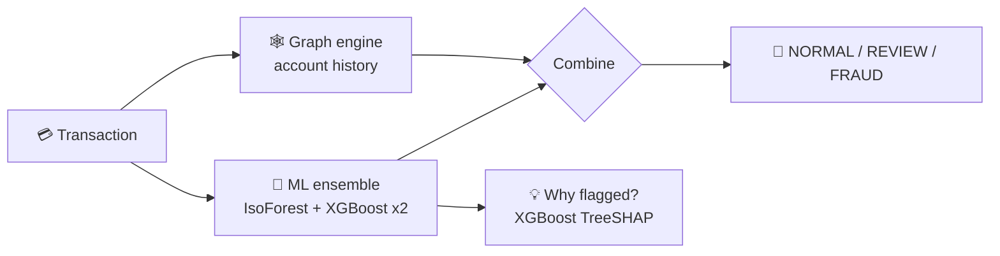
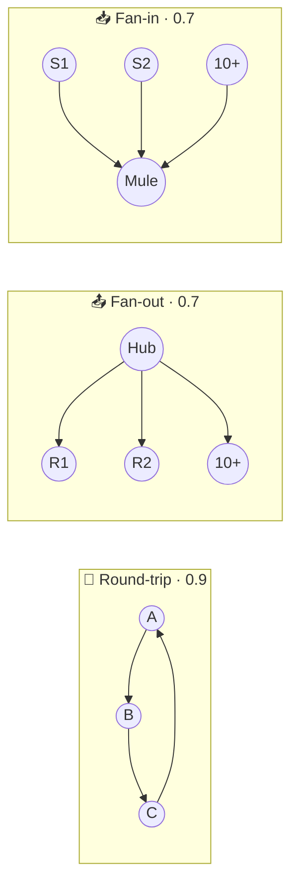

# 🕵️ Fund-Flow-Fraud-Detection

### AI-Powered Fraud Detection for Indian Payment Rails


Fund Flow detects fraudulent transactions by combining a **machine-learning ensemble** with **fund-flow graph analysis**, and explains every flagged decision in plain English so an analyst can see why it was raised.

---

## 🎯 Why Fund Flow?

Most fraud checks judge a transaction in isolation. But real fraud hides in patterns: amounts kept just under the reporting limit, money that leaves an account and returns through intermediaries, or one "mule" account collecting from dozens of senders. Fund Flow scores **what the transaction looks like** and **what the account has been doing**, then shows the reasons behind every flag.

---

## 🌐 Live Demo

🔗 https://fraudfindergraph-e14t.onrender.com

> 💡 Click **Guest mode** to try everything without signing up. The first load can take ~50 seconds (free hosting).

---

## 🏠 Platform Preview/Dashboard


---

## ✨ Key Features

- ⚡ Real-time Transaction Scoring (single, batch and CSV)
- 💡 SHAP-Based "Why Flagged?" Explanations
- 🕸️ Fund-Flow Graph Pattern Detection
- 🗺️ Interactive Graph of Flagged Transactions
- 📂 Smart CSV Upload with Auto Column Mapping
- 📄 PDF Investigation Reports
- 🗂️ Searchable Upload History
- 🔐 Email OTP, Google Login & Guest Mode

---

## ⚙️ How It Works

1. Submit a transaction, a batch, or a CSV file
2. The ML ensemble scores what the transaction looks like
3. The graph engine checks what the account has been doing
4. Both are combined into a risk level, with the reasons shown



---

## 🔍 Transaction Check

Enter one transaction and get an instant risk level with model-by-model scores and any graph patterns that fired. Optional fields (balances, time) fall back to safe defaults and the response tells you which ones.


---

## 💡 "Why Flagged?" Explainability

Every flagged transaction shows its **top 5 contributing features** as bars with plain-English reasons. These are the top feature contributions from XGBoost TreeSHAP, combined across the two XGBoost models to explain the ensemble's XGBoost component. The Isolation Forest is not part of this explanation, and graph patterns are shown separately as flags.


---

## 📂 CSV Upload & Batch Scoring

Upload a CSV and columns are matched automatically (`sender`, `from_account`, `amount`, `timestamp` and more). Missing optional fields pause the job for your confirmation, so nothing is assumed silently. Processing runs in the background.


---

## 🕸️ Fund-Flow Graph

Flagged transactions from an upload are drawn as an interactive network: **red** for FRAUD, **orange** for REVIEW. The engine detects four patterns:



🧩 **Structuring · 0.8**: 3 or more transfers inside the ₹40,000 to ₹49,999 band, just under the reporting limit.


---

## 🗂️ Upload History

Search past uploads with typo-tolerant fuzzy search, filter by status and date, paginate, and permanently delete jobs.


---

## 🔐 Secure Auth & Guest Mode

Sign up with email OTP, log in with Google, or reset your password by email. **Guest mode** gives full scoring without an account; nothing is saved.


---

## 📄 PDF Investigation Reports

Export a flagged case as a shareable PDF with its risk signals and fund-flow context, built with ReportLab.

---

## 📊 Model Performance

Trained on **PaySim** (6.36 million transactions, 0.129% fraud). Evaluated on a stratified 20% held-out test set of 1,272,524 transactions (1,643 fraud), `random_state=42`.

| Metric | Value |
|---|:-:|
| Ensemble AUC-ROC | **0.998** |
| Fraud precision at the FRAUD threshold | **0.89** |
| Fraud recall at the FRAUD threshold | **0.90** |
| Fraud F1 at the FRAUD threshold | **0.89** |
| Ensemble PR-AUC (average precision) | **0.956** |
| XGBoost V2 alone, PR-AUC | **0.967** |

| Model | Weight | AUC-ROC | Notes |
|---|:-:|:-:|---|
| Isolation Forest | 29.7% | 0.845 | Unsupervised anomaly score |
| XGBoost V2 | 35.2% | 0.9997 | 24 features, class-weighted, no SMOTE |
| XGBoost Exp3 | 35.1% | 0.9997 | 23 features, SMOTE |

**Thresholds:** `≥ 0.748` FRAUD · `≥ 0.4488` REVIEW · otherwise NORMAL.

> ⚠️ **Read these numbers honestly.** The ensemble weights, the FRAUD threshold (chosen to maximise F1) and the Isolation Forest normalisation range were all derived from the same test set, with no separate validation split, so precision, recall and F1 are optimistic estimates. With only 0.13% fraud, PR-AUC is more informative than AUC-ROC. On this data the blended ensemble (PR-AUC 0.956) does not beat XGBoost V2 alone (0.967); the Isolation Forest is included as an unsupervised signal for patterns the labels do not cover, which PaySim cannot demonstrate.

> 🔬 **Leakage removed.** An early 30-feature version scored ROC-AUC 0.9998 and PR-AUC 0.998, but it used balance-mismatch features (a PaySim simulator artifact) and sender/receiver velocity features (they count the current transaction, which is impossible in real time). Both groups were dropped; the clean 24-feature model has PR-AUC 0.967.

**Reproduce:** `python scripts/evaluate_model.py --data path/to/model_features.csv` re-runs the evaluation with the saved models and writes `docs/evaluation_results.json`. A run reproduced the training notebook's results (AUC-ROC 0.9983, precision 0.886, recall 0.901, F1 0.894) to within one borderline transaction, caused by the threshold being stored rounded to 4 decimals. The dataset is generated by `notebooks/01_EDA.ipynb` and is too large to ship in the repo.

---

## 🛠️ Tech Stack

| Layer | Technology |
|---|---|
| **Backend** | Python (FastAPI) |
| **Database** | PostgreSQL |
| **ML Engine** | XGBoost, Isolation Forest (scikit-learn) |
| **Explainability** | XGBoost TreeSHAP |
| **Graph** | NetworkX, PyVis |
| **Reports** | ReportLab |
| **Frontend** | Jinja2, Tailwind CSS, JavaScript |
| **Authentication** | bcrypt, Google OAuth (Authlib), Resend |
| **Deployment** | Render + Aiven |

---

## 📂 Project Structure

```
fund-flow-fraud/
├── models/                       # Trained models + ensemble_config.json
├── notebooks/                    # EDA, model training, graph analytics
├── scripts/
│   ├── compact_account_map.py    # Shrinks account-type lookup for 512 MB hosting
│   └── evaluate_model.py         # Re-computes ensemble metrics from saved models
├── src/
│   ├── app.py                    # FastAPI application
│   ├── config.py                 # Settings from environment variables
│   ├── auth/                     # OTP, sessions, Google OAuth, email
│   ├── core/
│   │   ├── ml_engine.py          # Features, ensemble scoring, SHAP
│   │   ├── graph_engine.py       # Fund-flow pattern detection
│   │   ├── csv_mapper.py         # CSV column auto-mapping
│   │   ├── explain_labels.py     # Feature → plain-English reason
│   │   └── db.py                 # PostgreSQL schema and queries
│   ├── routes/                   # predict, batch, file upload, graph, pages
│   ├── templates/                # Jinja2 pages
│   └── static/                   # CSS and JS
├── requirements.txt              # Runtime dependencies
└── requirements-dev.txt          # Notebook / training dependencies
```

---

## ⚙️ Installation & Setup

1. **Clone the repository**

```bash
git clone https://github.com/Shivam7977/fund-flow-fraud.git
cd fund-flow-fraud
```

2. **Install dependencies** (Python 3.12)

```bash
python -m venv venv
venv\Scripts\activate        # macOS/Linux: source venv/bin/activate
pip install -r requirements.txt
```

3. **Create a `.env` file** and add your keys:

```env
SECRET_KEY=your_long_random_secret
DATABASE_URL=your_postgresql_connection_string
RESEND_API_KEY=your_resend_api_key
GOOGLE_CLIENT_ID=your_google_client_id
GOOGLE_CLIENT_SECRET=your_google_client_secret
GOOGLE_REDIRECT_URI=http://127.0.0.1:8000/auth/google/callback
```

4. **Run the app** (from the `src` folder)

```bash
cd src
uvicorn app:app --reload
```

Open http://127.0.0.1:8000. Tables are created automatically on startup, and Swagger API docs are at `/docs`. Guest mode works without Google or Resend keys.

---

## 🚀 Deployment

| Setting | Value |
|---|---|
| **Build command** | `pip install -r requirements.txt` |
| **Start command** | `cd src && uvicorn app:app --host 0.0.0.0 --port $PORT` |
| **Environment** | `PYTHON_VERSION=3.12.7` plus the `.env` variables |
| **Database** | Managed PostgreSQL on Aiven |

The account-type lookup was shrunk from 70 MB of JSON to a 4 MB array so the app fits a free 512 MB instance, and a script verifies it returns identical answers for all 2.76 million accounts.

---

## ⚠️ Dataset Note

PaySim is a synthetic dataset. This project maps it into an Indian context (INR amounts, UPI / NEFT / ATM / NACH rails, account types, RBI reporting thresholds). It is **PaySim with an Indian regulatory-context overlay**, not real bank data. PaySim's fraud is rule-generated: in the test split every fraud case is a NEFT or ATM-withdrawal row, and 1,636 of 1,643 fall in a single amount-to-balance range. High scores here show the models learn the simulator well, not that they would perform the same on real banking traffic.

---

## 👨‍💻 Developer

Developed with ❤️ by **Shivam Pandey**

[](https://www.linkedin.com/in/shivam-pandey-0336ba336/)
[](https://shivam-ai-portfolio.netlify.app/)
[](https://github.com/Shivam7977)