# Fund Flow

     

**Catch suspicious transactions with an ML ensemble and fund-flow graph patterns, and see why each one was flagged.**

Fund Flow is a full-stack fraud detection app for Indian payment rails (UPI, NEFT, ATM, NACH). Check one transaction or upload a CSV, get a FRAUD, REVIEW or NORMAL risk level with the top reasons, and see the flagged transactions as a network graph. Guest mode lets you try everything without signing up.

| | |
|---|---|
| **Live demo** | [fraudfindergraph-e14t.onrender.com](https://fraudfindergraph-e14t.onrender.com) (click **Guest mode**) |
| **Stack** | FastAPI, PostgreSQL, XGBoost, Isolation Forest, TreeSHAP, NetworkX, PyVis, ReportLab |
| **Detection** | ML ensemble score plus four graph patterns (round-trip, structuring, fan-out, fan-in), combined into one risk level |
| **Result** | **F1 0.89** (95% interval 0.87 to 0.90) and **PR-AUC 0.95** on a held-out split of PaySim, a synthetic dataset |
| **Engineering** | Leakage audit with TreeSHAP, 24-hour windows on graph patterns, CSV column auto-mapping, background batch jobs |

## Why Fund Flow

Most fraud checks judge a transaction in isolation. But real fraud hides in patterns: amounts kept just under the reporting limit, money that leaves an account and returns through intermediaries, or one "mule" account collecting from dozens of senders. Fund Flow scores **what the transaction looks like** and **what the account has been doing**, then shows the reasons behind every flag so an analyst can see why it was raised.

## Key features

| Feature | What it does |
|---|---|
| **Transaction scoring** | Score one transaction, a JSON batch, or a whole CSV file through the same pipeline |
| **ML ensemble** | An Isolation Forest and two XGBoost models, weighted into one fraud score |
| **Graph pattern detection** | Round-trip, structuring, fan-out and fan-in patterns within 24-hour windows |
| **Why flagged** | The top five reasons for each flag in plain English, from XGBoost TreeSHAP |
| **Smart CSV upload** | Automatic column mapping, and a confirmation step instead of silent assumptions |
| **Fund-flow graph** | An interactive network of the flagged transactions in an upload |
| **PDF reports** | A shareable investigation report for every finished upload |
| **Upload history** | Typo-tolerant search, status and date filters, pagination, permanent delete |
| **Sign in and guest mode** | Email code, Google sign-in, password reset by email, or guest mode with nothing saved |

## Demo

The tour follows a first visit: landing page, sign in, dashboard, a single transaction check, a CSV upload, and the upload history.

**Landing page**  : The landing page introduces the product and leads to sign in or guest access.

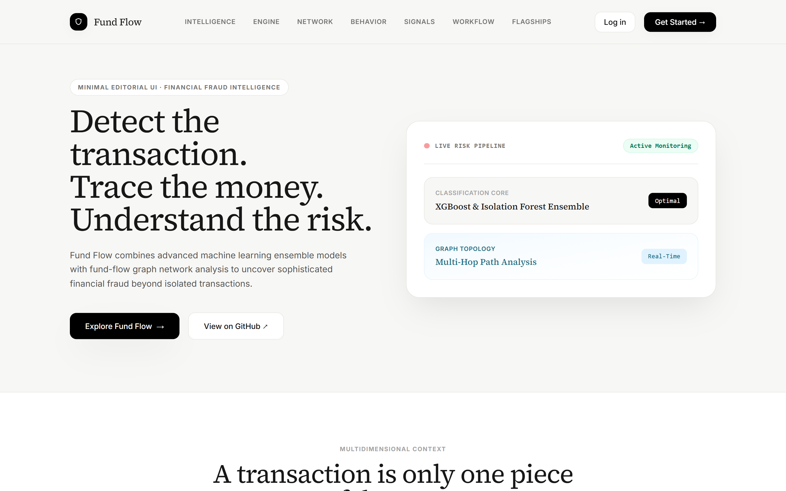

**Sign in**  : Sign up with your email and a one-time code that is valid for 10 minutes, log in with Google, or reset a forgotten password through an emailed link that is valid for one hour. **Guest mode** gives full scoring without an account, and nothing is saved.

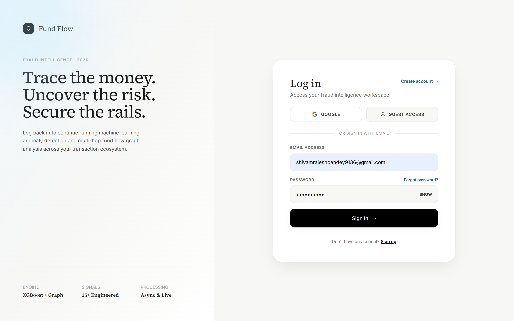

**Dashboard**  : A workspace overview with the totals for scored, fraud, review and normal transactions, plus your recent uploads.

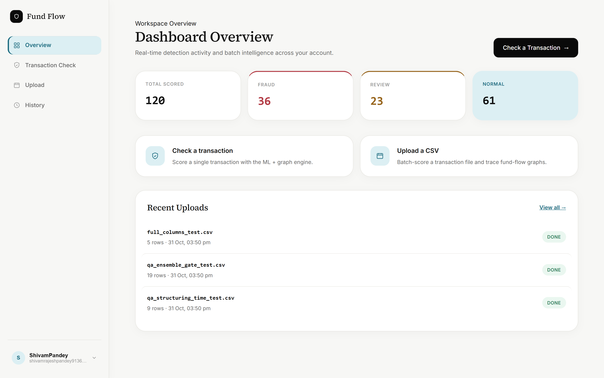

**Transaction check**  : Enter one transaction and get an instant risk level, the score from each model, and any graph patterns that fired. Sender, receiver, amount and payment rail are required. Balances and time are optional: if you leave them blank, neutral defaults are used and the response lists exactly which ones.

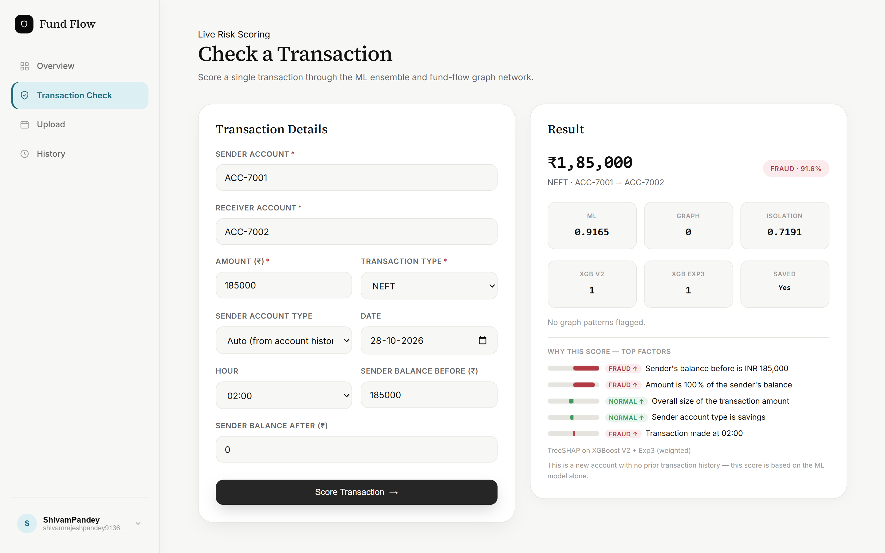

**Why flagged**  : Every flagged transaction shows its top five contributing features as bars, each with a plain-English reason such as "Amount is 98% of the sender's balance" or "Sender's balance drops to zero after this transaction". The reasons come from XGBoost TreeSHAP, combined across the two XGBoost models in proportion to their ensemble weights. The Isolation Forest is not part of this explanation, and graph patterns are shown separately as flags.

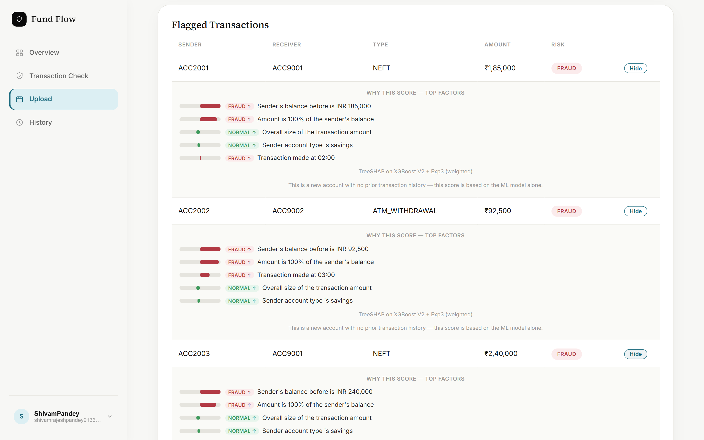

**CSV upload**  : Upload a CSV and the columns are matched automatically, ignoring case and spacing (`sender`, `from_account`, `amount`, `mode`, `timestamp` and more). A single timestamp column is enough, because hour, weekday and day are derived from it. If optional fields such as balances or time cannot be found, the job pauses and asks you to map a column or continue with defaults, so nothing is assumed silently. Scoring then runs as a background job.

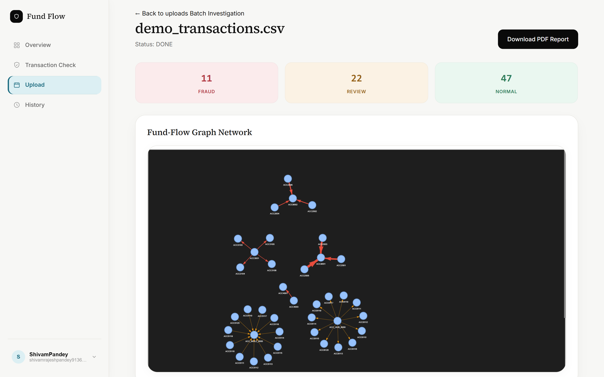

**Fund-flow graph**  : The flagged transactions from an upload are drawn as an interactive network you can drag and zoom. Red edges are FRAUD, orange edges are REVIEW, and thicker edges carry larger amounts. Hover an edge to see the amount, risk level and score.

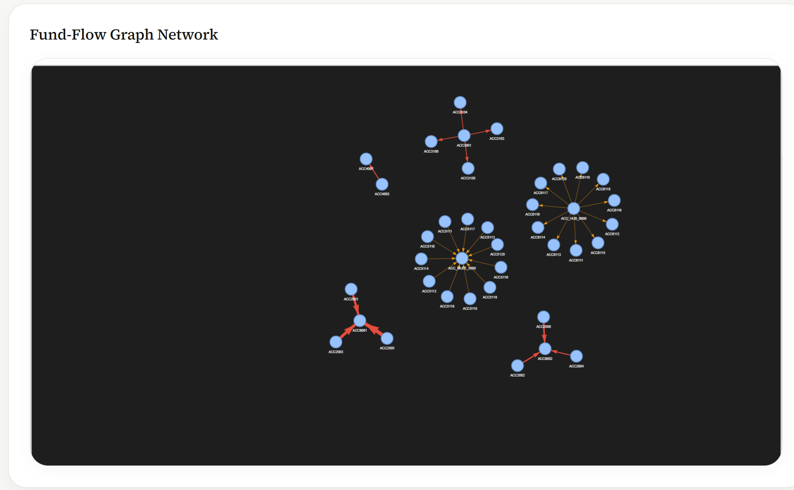

**Upload history**  : Search past uploads with typo-tolerant fuzzy search, filter by status and date, page through results, and delete a job permanently after a confirmation. Every finished upload can be exported as a PDF report with six sections: executive summary, risk distribution, financial summary, fund-flow graph findings, flagged transaction details, and a methodology note.

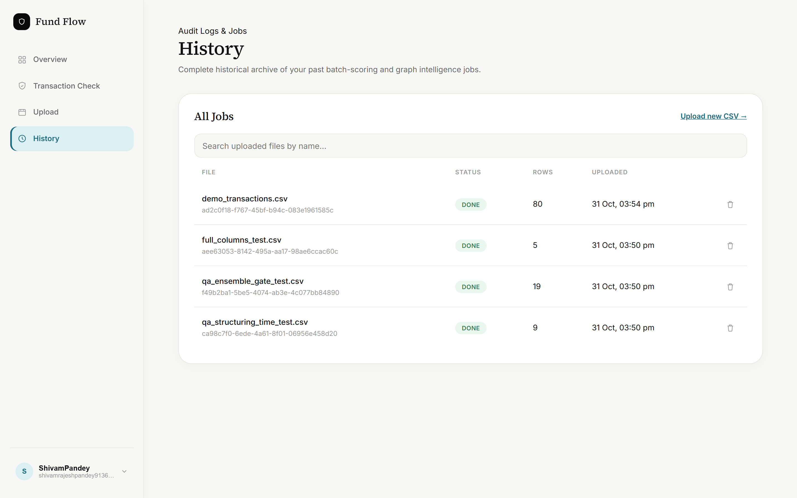

## Architecture

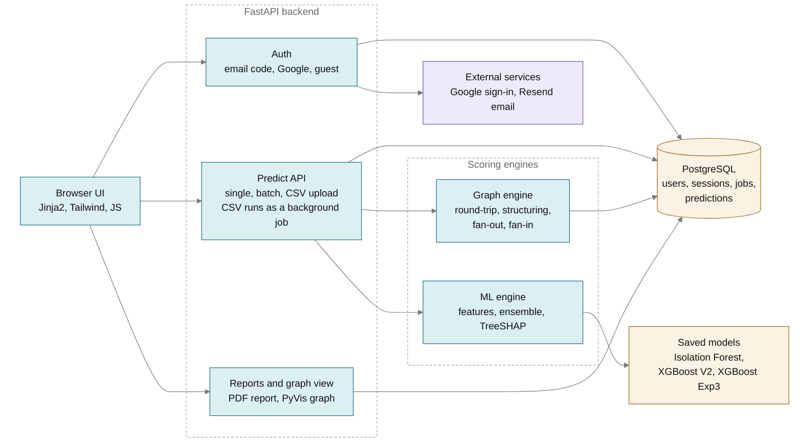

## How it works

### Scoring: from transaction to risk level

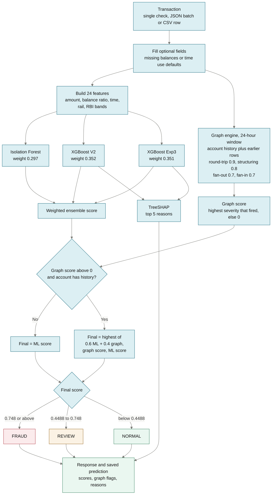

The final score is the ML score. If a graph pattern fires and the account has history, it becomes the highest of `0.6 * ML + 0.4 * graph`, the graph score, and the ML score. TreeSHAP explains the two XGBoost models, so the Isolation Forest and the graph flags are shown separately.

### CSV upload: from file to report

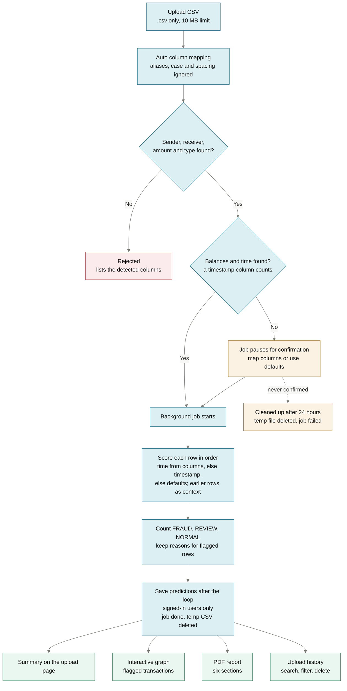

### Graph patterns

Each pattern is checked within a 24-hour window around the transaction. Structuring, fan-out and fan-in use the account's saved history plus the earlier rows of the same upload. Round-trip uses only the current upload or batch.

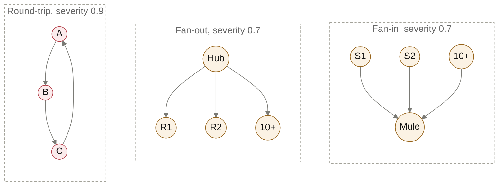

Pink shapes reach FRAUD on their own and cream shapes reach REVIEW. A fourth pattern, structuring, has no special shape: it is one account making repeated payments in the same narrow amount band.

| Pattern | What it detects | Why it matters | Severity | Result on its own |
|---|---|---|:-:|---|
| **Round-trip** | Money returns to its origin through 2 or 3 intermediaries (A, B, C, back to A) | A classic sign of layering, money moved in a loop to hide its source | 0.9 | FRAUD |
| **Structuring** | 3 or more payments from one account in the ₹40,000 to ₹49,999 band | Payments kept just under the reporting limit to avoid attention | 0.8 | FRAUD |
| **Fan-out** | One account pays 10 or more different receivers | Money dispersed to many accounts at once | 0.7 | REVIEW |
| **Fan-in** | One account receives from 10 or more different senders | The shape of a mule account collecting funds | 0.7 | REVIEW |

The highest severity among the patterns that fired becomes the graph score. The graph can only raise a score, never lower it.

## Key engineering decisions

| Decision | Why | Evidence |
|---|---|---|
| Drop balance-mismatch and velocity features | Balance mismatch is a PaySim simulator artifact, and the velocity counts include the current transaction, which is impossible in real time | PR-AUC fell from 0.998 to 0.97 after removal (`notebooks/02_model_training.ipynb`) |
| Report a tune and hold-out split | The weights, threshold and Isolation Forest range were first derived on the same test set that was reported | `scripts/evaluate_holdout.py`, `docs/holdout_evaluation.json` |
| Graph score can only raise the final score | Averaging would dilute a strong pattern, and a clean history must not pull down a confident ML score | `_combine` in `src/routes/predict.py` |
| 24-hour window on graph patterns | Without it, three ₹45,000 payments made months apart were flagged as structuring | Tested: payments 90 days apart no longer flag, same-day payments still flag |
| Score each CSV row with earlier rows as context, save after the loop | Patterns inside one file are caught without a database round trip, and no transaction is counted twice | `process_file_job` in `src/routes/predict_file.py` |
| Pause the job when optional fields are missing | Nothing is assumed silently | `POST /predict/file/{job_id}/confirm` |
| TreeSHAP from XGBoost's own `pred_contribs` | Exact for trees, and the runtime needs no extra `shap` package | `explain_features` in `src/core/ml_engine.py` |
| Shrink the account-type lookup from 70 MB JSON to a 4 MB array | Fits a free 512 MB instance | `scripts/compact_account_map.py` checks that every lookup returns the same answer |

## Results

Trained on **PaySim**: 6.36 million transactions, 8,213 of them fraud (0.129%). The 20% stratified test split (`random_state=42`) was divided in half. The ensemble weights, Isolation Forest range and FRAUD threshold were re-derived on the **tune** half, and the numbers below come from the **hold-out** half (636,262 transactions, 821 fraud) that none of those choices saw. Intervals are 95% bootstrap intervals over 200 resamples.

**About the data.** PaySim is a synthetic mobile-money dataset. Fund Flow maps it into an Indian context: amounts are converted to INR at a fixed rate, PaySim's transaction types become UPI, NEFT, ATM withdrawal, cash deposit and NACH, and RBI-style thresholds (the ₹40,000 to ₹49,999 structuring band, the ₹2 lakh RTGS range and the ₹10 lakh reporting level) become features. It is PaySim with an Indian regulatory-context overlay, not real bank data.

**The models.** Three models are blended into one score. The weights are proportional to each model's ROC-AUC on the 20% test split.

| Model | Weight | ROC-AUC alone | Notes |
|---|:-:|:-:|---|
| Isolation Forest | 29.7% | 0.845 | Unsupervised anomaly score, trained without labels |
| XGBoost V2 | 35.2% | 0.9997 | 24 features, class weighting (`scale_pos_weight` 774), no SMOTE |
| XGBoost Exp3 | 35.1% | 0.9997 | 23 features (no `type_UPI`), SMOTE plus class weighting |

**Thresholds.** A final score of `0.748` or above is FRAUD, `0.4488` or above is REVIEW (0.6 times the FRAUD threshold), and anything lower is NORMAL.

**Hold-out results.**

| Setup | Precision | Recall | F1 | PR-AUC |
|---|---:|---:|---:|---:|
| XGBoost V2 alone | 0.921 | 0.866 | 0.893 (0.879 to 0.906) | 0.967 |
| XGBoost Exp3 alone | 0.933 | 0.791 | 0.856 (0.837 to 0.873) | 0.950 |
| V2 + Exp3 average | 0.881 | 0.932 | 0.906 (0.892 to 0.920) | 0.970 |
| **Ensemble (Isolation Forest + V2 + Exp3)** | **0.886** | **0.895** | **0.890 (0.874 to 0.905)** | **0.954** |

> **Read these numbers with context.** PaySim is synthetic, so the scores show that the models learned the simulator, not that they would perform the same on real banking traffic. The graph patterns were checked on injected synthetic scenarios only, with no real-data evaluation. The train and test split is random, not time-based. Details are in the methodology notes below.

**What the leakage audit changed.** TreeSHAP showed a single feature, `balance_mismatch`, dominating an early 30-feature model. Removing the leaking features lowered every score, which is the honest result:

| Features | ROC-AUC | PR-AUC | Precision at top 1,643 |
|---|---:|---:|---:|
| All 30 | 0.9998 | 0.9976 | 0.9976 |
| Without balance mismatch (28) | 0.9994 | 0.9704 | 0.8929 |
| Without mismatch and velocity (24, shipped) | 0.9997 | 0.9685 | 0.8947 |

Precision at top 1,643 means flagging as many transactions as there are real fraud cases in the test split. These are single 300-tree XGBoost experiments from the training notebook.

Reproduce: `python scripts/evaluate_holdout.py --data path/to/model_features.csv`. The dataset is generated by `notebooks/01_EDA.ipynb` and is too large to ship in the repo.

<details>
<summary>Methodology and caveats</summary>

- **Metric choice.** With 0.13% fraud, ROC-AUC is about 0.999 for almost any model, so PR-AUC and F1 are the primary metrics.
- **The ensemble is not the top scorer.** The V2 + Exp3 average has a slightly higher F1 (0.906 against 0.890), though the intervals overlap. The Isolation Forest (ROC-AUC 0.845 alone) is kept as an unsupervised signal for patterns the labels do not cover, which PaySim cannot demonstrate.
- **A built-in gate.** The two XGBoost weights add up to 0.703, below the 0.748 FRAUD threshold. An ML-only FRAUD label therefore also needs some Isolation Forest signal.
- **Still mildly optimistic.** Hyperparameters and feature choices (for example dropping `type_UPI` for Exp3) were made while looking at the full test split. A fully clean estimate needs a train, validation and test split with a re-train.
- **Synthetic data.** PaySim fraud is rule-generated. In the test split every fraud case is a NEFT or ATM-withdrawal row, and 1,636 of 1,643 fall in one amount-to-balance range. High scores show the models learned the simulator, not that they would perform the same on real banking traffic.
- **India overlay.** The project maps PaySim into an Indian context (INR amounts, UPI, NEFT, ATM and NACH rails, RBI-style thresholds). Account types in the training data were assigned at random, so they carry no real signal.
- **Graph patterns are checked on synthetic scenarios only.** PaySim contains no round-trip cycles (none in 2.77 million NEFT and ATM edges), so patterns were injected for testing. There is no precision or recall for graph patterns on real data.
- **Random split.** The train and test split is random, not time-based.

</details>

## Security

- Passwords are hashed with bcrypt. Sign-up is confirmed with an emailed code that expires after 10 minutes.
- Sessions use a random token stored server-side in PostgreSQL. The cookie is HttpOnly, SameSite=Lax, and Secure over HTTPS.
- Sign-up, login and forgot-password are rate-limited per client address.
- Upload history, reports and deletes are scoped to the signed-in owner. Other users get a 404.
- CSV uploads accept `.csv` only, up to 10 MB. Temporary files are deleted after processing, abandoned jobs are cleaned up at startup, and internal file paths are never returned to the client.
- Uploaded file names are escaped in the interface and sanitized in the PDF file name.
- Secrets come from environment variables or a git-ignored `.env` file.

**What leaves the server.** Scoring runs on the server with the saved models. No transaction data goes to a third-party ML service.

| Feature | Provider | What is sent |
|---|---|---|
| Google sign-in | Google | The sign-in request and token |
| Sign-up and password reset | Resend | Email address and the one-time code or reset link |

Guest-mode results are never saved.

<details>
<summary>Limits and known gaps</summary>

- Trained and evaluated on synthetic PaySim data. Treat the scores as a demonstration of the method, not a production fraud model.
- Missing balances and time fall back to neutral defaults (0). Scores are less reliable when those fields are missing, and the response lists which defaults were used.
- Transaction type must be one of `ATM_WITHDRAWAL`, `CASH_DEPOSIT`, `NACH`, `NEFT`, `UPI`, the five rails the models were trained on.
- Time windows use `day * 24 + hour`. A CSV with only dates is treated as same-date, and a CSV with no date or time puts every row on day 0, so the window cannot filter anything.
- Detection runs in row order. Rows before a pattern reaches its threshold are scored without it.
- The graph view draws only the transactions that were flagged, not every transaction in a pattern.
- Round-trip detection covers 3 and 4 hop cycles inside the current upload. Layering chains are explored in `notebooks/03_graph_analytics.ipynb` but are not part of the app.
- CSV uploads are capped at 10 MB. Batch jobs run as in-process background tasks, so a server restart interrupts a running job. The rate limiter is in memory, so it works with one server process.
- Guest uploads are not saved, so there is no history or PDF report for guests.
- There are no automated tests yet.

</details>

## Tech stack

| Layer | Technology |
|---|---|
| **Backend** | Python 3.12, FastAPI |
| **Database** | PostgreSQL (psycopg2 connection pool) |
| **ML engine** | XGBoost, Isolation Forest (scikit-learn) |
| **Explainability** | XGBoost TreeSHAP (`pred_contribs`) |
| **Graph** | NetworkX, PyVis |
| **Reports** | ReportLab |
| **Frontend** | Jinja2, Tailwind CSS, JavaScript |
| **Authentication** | bcrypt, Google OAuth (Authlib), Resend |
| **Deployment** | Render, Aiven PostgreSQL |

## Project structure

```
fund-flow-fraud/
├── models/                       # Isolation Forest, two XGBoost models, ensemble_config.json
├── data/                         # Compact account-type lookup (the dataset itself is not committed)
├── docs/
│   ├── demo/                     # README screenshots
│   ├── holdout_evaluation.json   # Tune and hold-out results with intervals
│   └── evaluation_results.json   # Original test-set results (optimistic)
├── notebooks/
│   ├── 01_EDA.ipynb              # Exploration, India-context mapping, feature engineering
│   ├── 02_model_training.ipynb   # Training, ensemble, leakage investigation
│   └── 03_graph_analytics.ipynb  # Graph pattern prototypes on synthetic injections
├── scripts/
│   ├── compact_account_map.py    # Shrinks the account-type lookup for a 512 MB host
│   ├── evaluate_model.py         # Re-computes test-set metrics from the saved models
│   └── evaluate_holdout.py       # Tune and hold-out evaluation with bootstrap intervals
├── src/
│   ├── app.py                    # FastAPI application and health endpoints
│   ├── config.py                 # Settings from environment variables
│   ├── auth/                     # Email code, sessions, Google sign-in, email sending
│   ├── core/
│   │   ├── ml_engine.py          # Features, ensemble scoring, TreeSHAP
│   │   ├── graph_engine.py       # Round-trip, structuring, fan-out, fan-in
│   │   ├── csv_mapper.py         # CSV column auto-mapping and time fields
│   │   ├── explain_labels.py     # Feature to plain-English reason
│   │   ├── pdf_report.py         # PDF investigation report
│   │   └── db.py                 # PostgreSQL schema and queries
│   ├── routes/                   # Predict, batch, CSV upload, graph, pages
│   ├── templates/                # Jinja2 pages
│   └── static/                   # CSS and JavaScript
├── requirements.txt              # Runtime dependencies
└── requirements-dev.txt          # Notebook and training dependencies
```

## Deployment

The live demo runs on Render with a managed PostgreSQL database on Aiven.

| Setting | Value |
|---|---|
| **Build command** | `pip install -r requirements.txt` |
| **Start command** | `cd src && uvicorn app:app --host 0.0.0.0 --port $PORT` |
| **Environment** | `PYTHON_VERSION=3.12.7` plus the variables in the configuration table below |
| **Database** | Managed PostgreSQL on Aiven |
| **Health checks** | `/health` (no database) and `/health/db` (also checks PostgreSQL) |

The account-type lookup was shrunk from 70 MB of JSON to a 4 MB array so the app fits a free 512 MB instance, and `scripts/compact_account_map.py` checks that it returns identical answers for every account. The app also creates the `pg_trgm` extension at startup for fuzzy search, so the database user needs permission to create it, or an admin must enable it once.

## Quick start

Requirements: Python 3.12 and a PostgreSQL database. The trained models and the account-type lookup are in the repo, so the dataset is not needed to run the app.

```bash
git clone https://github.com/Shivam7977/fund-flow-fraud.git
cd fund-flow-fraud
python -m venv venv
venv\Scripts\activate          # macOS and Linux: source venv/bin/activate
pip install -r requirements.txt
```

Create a `.env` file in the project root:

```env
SECRET_KEY=your_long_random_secret
DATABASE_URL=your_postgresql_connection_string
```

Run the app from the `src` folder:

```bash
cd src
uvicorn app:app --reload
```

Open [http://127.0.0.1:8000](http://127.0.0.1:8000). API docs are at `/docs`. Tables and indexes are created at startup. Guest mode works without any Google or email keys.

<details>
<summary>Configuration</summary>

| Variable | Default | Purpose |
|---|---|---|
| `DATABASE_URL` | none | PostgreSQL connection string. Required. |
| `SECRET_KEY` | placeholder value | Signs the session middleware. Always set a long random value. |
| `RESEND_API_KEY` | none | Enables sign-up and password-reset emails. |
| `GOOGLE_CLIENT_ID`, `GOOGLE_CLIENT_SECRET` | none | Enable Google sign-in. |
| `GOOGLE_REDIRECT_URI` | `http://127.0.0.1:8000/auth/google/callback` | Must match the URI registered in Google Cloud. |

</details>

<details>
<summary>API</summary>

| Endpoint | Purpose |
|---|---|
| `GET /health`, `GET /health/db` | Liveness and database checks |
| `POST /auth/signup`, `/auth/verify-otp`, `/auth/login`, `/auth/logout` | Account sign-up with an email code, and sessions |
| `POST /auth/guest-login`, `GET /auth/google/login` | Guest mode and Google sign-in |
| `POST /auth/forgot-password`, `/auth/reset-password`, `/auth/set-password` | Password reset and setting a password |
| `POST /predict` | Score one transaction, with explanation |
| `POST /predict/batch` | Score a list of transactions |
| `POST /predict/file` | Upload a CSV and start a job |
| `POST /predict/file/{job_id}/confirm` | Confirm column mapping or continue with defaults |
| `GET /predict/file/{job_id}` | Job status |
| `GET /predict/file/{job_id}/graph` | Interactive graph of flagged transactions |
| `GET /uploads`, `GET /uploads/{job_id}` | Search upload history, read one upload |
| `GET /uploads/{job_id}/report` | Download the PDF report |
| `DELETE /uploads/{job_id}` | Permanently delete an upload |
| `GET /activity` | Totals for the dashboard |

</details>

<details>
<summary>Troubleshooting</summary>

- **`Directory 'static' does not exist`:** the app was started from the wrong folder. Run `uvicorn app:app --reload` from inside `src`.
- **Startup fails on `pg_trgm`:** enable it once with `CREATE EXTENSION IF NOT EXISTS pg_trgm;` using a database admin account.
- **CSV rejected with required columns missing:** the file needs sender, receiver, amount and type columns. Common names such as `sender`, `from_account`, `amount` and `mode` are matched automatically.
- **Scores look odd for a CSV:** check that the type column uses the five supported rails, and that balances and time columns are mapped rather than left to defaults.
- **Sign-up emails do not arrive:** set `RESEND_API_KEY`. Guest mode works without it.
- **First request is slow on the live demo:** free hosting sleeps when idle. Point an uptime monitor at `/health` to keep it warm.

</details>

## License

MIT. See [LICENSE](LICENSE).

## Developer

Built by **Shivam Pandey**.

[](https://www.linkedin.com/in/shivam-pandey-0336ba336/) [](https://shivam-ai-portfolio.netlify.app/) [](https://github.com/Shivam7977)